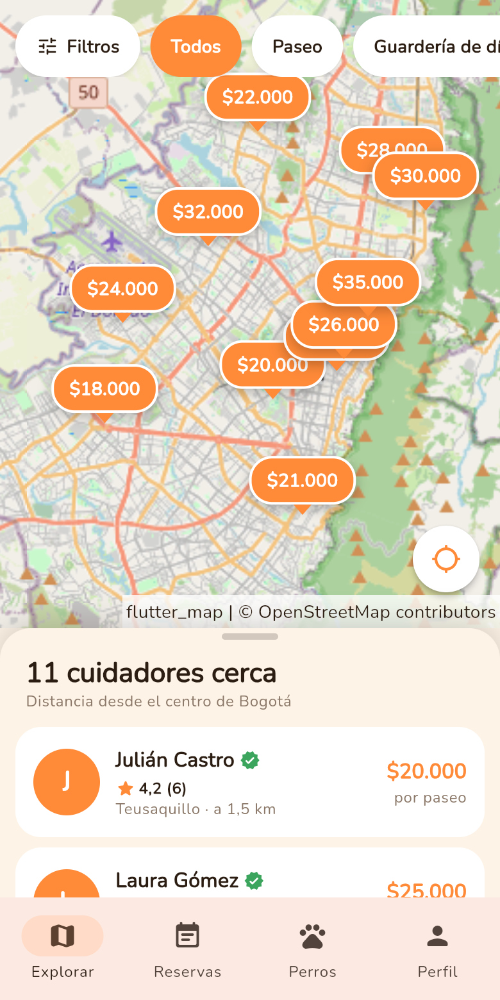
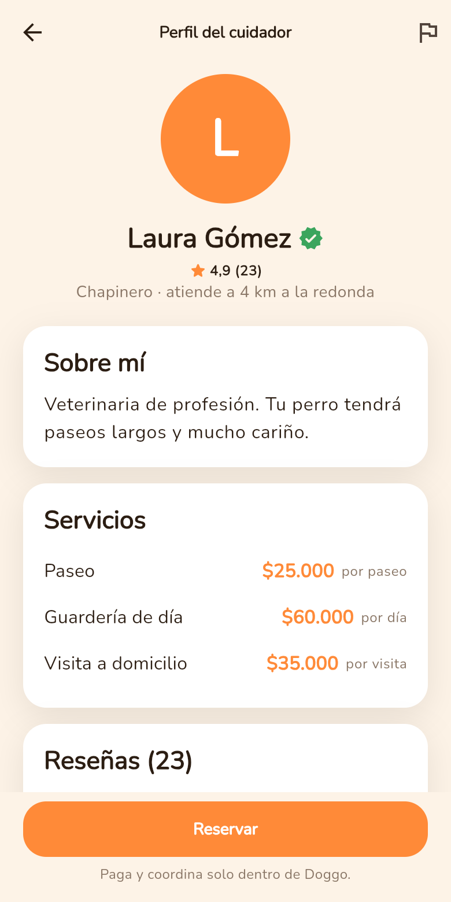
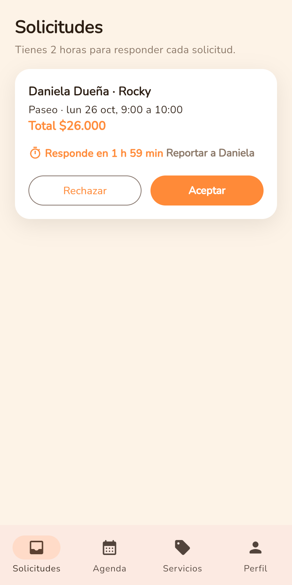
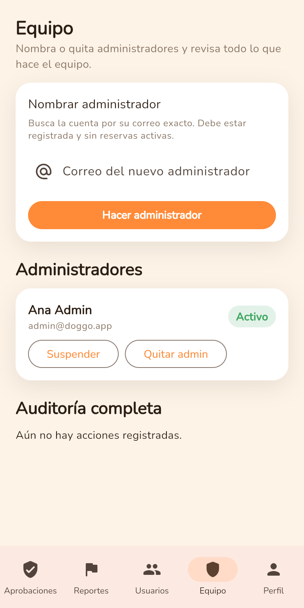

<p align="center"></p>

# Doggo

Encuentra cuidadores de perros cerca de ti en Bogotá: paseos, guardería de día, hospedaje y visitas a domicilio.
Los cuidadores pasan por revisión antes de salir en el mapa, y el contacto solo se comparte con una reserva aceptada.

| Mapa | Perfil del cuidador | Solicitudes del cuidador | Panel del superadmin |
|---|---|---|---|
|  |  |  |  |

## Probar ahora (sin instalar nada)

**https://doggotech.github.io/Doggo/**

Toca **Probar demo** y entras como dueño. Para cambiar de rol sin cerrar sesión, ve a **Perfil → Modo demo** (arriba del todo).
También puedes entrar con estas cuentas (contraseña `doggo123`; son de demostración, no son secretas):

| Rol | Correo |
|---|---|
| Dueño | `dueno@doggo.app` |
| Cuidador | `cuidador@doggo.app` |
| Administrador | `admin@doggo.app` |
| Superadministrador | `superadmin@doggo.app` |

### Guion de 1 minuto

1. Como **dueño**, toca el pin de **Carlos Cuidador** en el mapa → **Reservar** → elige a Rocky, el día y la hora → **Enviar solicitud**.
2. **Perfil → Modo demo → Cuidador**: la solicitud está en **Solicitudes**, con el plazo de 2 horas para responder. Toca **Aceptar**.
3. **Perfil → Modo demo → Dueño → Reservas**: la reserva sale aceptada y ahora sí ves el teléfono y la dirección del cuidador.

> **Modo demo:** por ahora la app corre con datos de ejemplo guardados en tu navegador. Cada visitante tiene su propia copia y se reinicia al recargar la página, así que dos personas no se ven entre sí. El tiempo real entre dispositivos llega al conectar Supabase (ver [Pendientes](#pendientes)).

## Instalar en el celular

- **iPhone (Safari):** abre el link → botón **Compartir** → **Agregar a inicio**.
- **Android (Chrome):** abre el link → menú **⋮** → **Instalar app**.
- **APK de Android:** descárgalo de [Releases](https://github.com/DoggoTech/Doggo/releases) e instálalo (Android pedirá permitir apps de origen desconocido). Está firmado con una clave de prueba: para actualizarlo, desinstala la versión anterior. En iPhone no se puede instalar así sin una cuenta de Apple Developer; usa el link.

En todos los casos, acepta el permiso de ubicación para ver cuidadores cerca de ti. En Mac, además, activa **Ajustes del Sistema → Privacidad y seguridad → Localización** para tu navegador.

## Confianza y seguridad

- **La seguridad vive en la base de datos**, no en la interfaz: reglas por fila (RLS), permisos por columna y funciones que validan el rol por dentro. Nadie puede darse permisos de admin ni cambiar su estado con una llamada directa a la API (está probado).
- **Cuidadores revisados:** un cuidador nuevo queda *en revisión* y no sale en el mapa hasta que un admin lo aprueba. Aprobar es verificar: el admin revisa documento y selfie, y el cuidador sale con la insignia **Verificado**.
- **Privacidad:** el mapa muestra una ubicación aproximada (200–300 m de la real). Teléfono, dirección y notas del perro solo se ven con una reserva **aceptada**.
- **Sin datos de contacto en textos públicos:** la bio y los comentarios rechazan teléfonos, correos y enlaces.
- **Reportes y moderación:** cualquiera puede reportar a otro usuario; los admins atienden reportes y suspenden cuentas. Un usuario suspendido desaparece del mapa y no puede entrar.
- **Equipo y auditoría:** solo el superadmin nombra o quita admins y elimina cuentas. Cada acción queda en un historial que el superadmin ve completo y cada admin ve solo lo suyo.

**Prueba la moderación:** como **Administrador**, en **Aprobaciones** aprueba a Natalia Peña → cambia a **Dueño** → Natalia aparece en el mapa con la insignia Verificado.

## Correr en local

Necesitas [Flutter](https://docs.flutter.dev/get-started/install) estable (probado con 3.47.8) y VS Code con las extensiones **Flutter** y **Dart**.

```bash
git clone https://github.com/DoggoTech/Doggo.git && cd Doggo
cp env.example.json env.json   # las claves vacías = modo demo
flutter pub get
flutter run -d chrome --dart-define-from-file=env.json
```

Desde VS Code: **F5** con una de las configuraciones de `.vscode/launch.json` (Chrome, iOS Simulator o emulador Android). Al guardar, la app se recarga sola (hot reload).

- **Mac:** instala Xcode → Flutter → `flutter doctor` → `open -a Simulator` → elige un iPhone → F5.
- **Windows / Linux:** Flutter → Android Studio (para el emulador) o Chrome → `flutter doctor` → F5. Para ver el tamaño de un celular en Chrome: **F12 → modo dispositivo**.

### Pruebas

```bash
flutter test         # lógica de la app (repositorio demo)
npm install
npm run test:db      # base de datos: RLS, triggers y RPC sobre Postgres real (PGlite)
npm run test:full    # compila la web y corre las pruebas e2e con Playwright (~8 min)
```

## Montar tu propio backend (Supabase)

1. Crea un proyecto en [supabase.com](https://supabase.com) (plan gratis).
2. En el **SQL Editor**, corre `supabase/schema.sql` y luego `supabase/seed.sql`.
3. En **Authentication → Providers → Email**, desactiva la confirmación de correo (para la demo).
4. Crea las 4 cuentas de prueba en **Authentication → Users** y corre `supabase/assign_roles.sql` para darles su rol.
5. Copia **Project URL** y **anon key** (Settings → API) en `env.json`.

La clave **anon** es pública por diseño: la protección está en las reglas de la base. La clave **service_role** nunca va en la app ni en el repositorio.

> La conexión de la app con Supabase (`SupabaseRepository`) aún está pendiente; mientras tanto la app usa el modo demo aunque `env.json` tenga claves.

## Publicación (para quien mantiene el repositorio)

- **Web:** cada push a `main` corre `.github/workflows/deploy.yml` (análisis, pruebas, compilación con `--base-href /Doggo/` y publicación). Requiere **Settings → Pages → Source: GitHub Actions**.
- **APK:** `.github/workflows/apk.yml` corre al crear un tag `v*` (p. ej. `git tag v0.1.0 && git push origin v0.1.0`) o a mano desde **Actions**, y adjunta `doggo.apk` a un Release.
- **Secretos:** al conectar Supabase, carga `SUPABASE_URL` y `SUPABASE_ANON_KEY` en **Settings → Secrets and variables → Actions**. Sin ellos, todo se publica en modo demo.
- **Keep-alive:** el plan gratis de Supabase pausa el proyecto tras 7 días sin uso. `.github/workflows/keepalive.yml` le hace un ping cada 2 días. Ten en cuenta que:
  - GitHub desactiva los workflows programados si el repositorio pasa **60 días sin commits**; se reactivan en la pestaña **Actions**.
  - Si el proyecto ya está pausado, el ping **no lo despierta**: hay que reactivarlo una vez desde el panel de Supabase (*Restore*).
  - El backend en plan gratis puede tardar unos segundos en responder si estuvo inactivo. Si falla, usa **Probar demo**.

## Arquitectura

- **Flutter** (un solo código para web, Android e iOS) con **Riverpod** y **go_router**; mapa con **flutter_map + OpenStreetMap**.
- **Supabase** (Auth, Postgres, Realtime, Storage) sin servidor propio.
- **Patrón Repository:** `DemoRepository` (en memoria, el que corre hoy) y `SupabaseRepository` (pendiente), intercambiables sin tocar la interfaz.

Detalle en [`docs/decisiones-de-arquitectura.md`](docs/decisiones-de-arquitectura.md) y [`docs/modelo-de-datos.md`](docs/modelo-de-datos.md).

## Pendientes

1. **Conectar Supabase** (`SupabaseRepository`): cuentas reales y reservas en tiempo real entre dispositivos.
2. **Pulido:** agrupar pines superpuestos en el mapa, animaciones y estados vacíos.
3. **Después del MVP:** beneficios para cuidadores con buena calificación.
