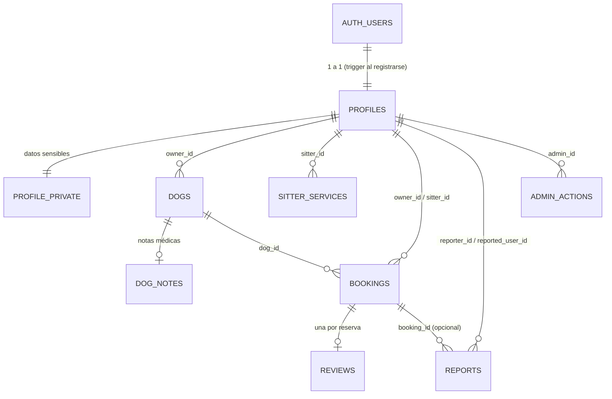

# Modelo de datos de Doggo

Fuente de verdad: [`supabase/schema.sql`](../supabase/schema.sql). Este documento es la guía para estudiarlo.

## Arquitectura en una línea

Flutter habla con **Supabase** (Auth + Postgres + Realtime + Storage) sin servidor propio.
**La seguridad vive en la base**: ocultar un botón no protege nada; las políticas RLS, los
`CHECK`, los triggers y los permisos de columna sí. Las acciones de moderación solo existen como
funciones RPC (`security definer`) que validan el rol de quien llama y dejan auditoría.

## Diagrama de relaciones



## Tipos (enums)

| Tipo | Valores |
|---|---|
| `user_role` | `owner`, `sitter`, `admin`, `superadmin` |
| `user_status` | `pending_review`, `approved`, `suspended` |
| `service_type` | `walk`, `daycare`, `boarding`, `home_visit`, `grooming`, `training` |
| `booking_status` | `pending`, `accepted`, `rejected`, `cancelled`, `completed` |
| `report_reason` | `inappropriate_behavior`, `fake_profile`, `off_platform_payment`, `animal_abuse`, `other` |
| `report_status` | `open`, `reviewed`, `dismissed` |
| `dog_size` | `small`, `medium`, `large`, `giant` |

## Tablas

### `profiles`: perfil público
| Columna | Tipo | Notas |
|---|---|---|
| `id` | uuid PK | = `auth.users.id` (cascade) |
| `role` | user_role | default `owner`. **Índice único parcial**: solo un `superadmin` |
| `full_name` | text | ≤ 80 |
| `avatar_url`, `bio` | text | `bio` ≤ 600 y **sin teléfonos, correos ni enlaces** (CHECK) |
| `approx_lat`, `approx_lng` | double | ubicación del mapa (la calcula un trigger, ver abajo) |
| `radius_km` | int | 1–50 |
| `status` | user_status | cuidador nuevo → `pending_review`; dueño → `approved` |
| `verified` | bool | insignia "Verificado" (solo la da un admin) |
| `terms_accepted_at` | timestamptz | se guarda al registrarse |

- **Lee:** el propio usuario · cualquiera los cuidadores `approved` (incluido `anon`) · la contraparte de una reserva · el admin.
- **Escribe:** el propio usuario, **solo** `full_name`, `avatar_url`, `bio`, `radius_km` (permiso por columna + trigger de respaldo). `role`, `status`, `verified` y `approx_*` no se pueden tocar desde la API.

### `profile_private`: datos sensibles
`id` (PK/FK), `phone` (formato validado), `exact_lat`, `exact_lng`, `address`.
- **Lee:** el dueño · la contraparte **solo con reserva `accepted`**.
- **Escribe:** el dueño. Al guardar la ubicación exacta, un trigger calcula `profiles.approx_*`, desplazada **200–300 m** de forma determinista por usuario (si fuera aleatoria en cada guardado, se podría promediar y recuperar la exacta).

### `dogs`
`id`, `owner_id` → profiles, `name`, `breed`, `size`.
- **Lee:** el dueño · el cuidador con una reserva `pending` o `accepted` de ese perro.
- **Escribe:** el dueño (rol `owner`).

### `dog_notes`: notas médicas y de comportamiento
`dog_id` (PK/FK), `notes` (≤ 1000, sin datos de contacto).
Es una tabla aparte porque RLS filtra **filas**, no columnas: así las notas se ven solo con reserva **`accepted`**, mientras el nombre y la raza se ven desde `pending`.

### `sitter_services`
`id`, `sitter_id`, `service_type`, `price_cop` (**5.000–2.000.000**), `active`; único `(sitter_id, service_type)`.
- **Lee:** público los activos de cuidadores `approved` (incluye `anon`: el keep-alive los consulta) · el propio cuidador · el admin.
- **Escribe:** el cuidador, solo los suyos.

### `bookings`
| Columna | Notas |
|---|---|
| `owner_id`, `sitter_id`, `dog_id` | `owner_id <> sitter_id` (CHECK) |
| `service_type`, `start_at`, `end_at` | `end_at > start_at` (CHECK) |
| `total_cop` | **lo calcula la base**: precio × unidades (guardería y hospedaje, por día/noche) |
| `status` | máquina de estados protegida por trigger |

Validaciones en el `INSERT` (trigger): `start_at` en el futuro · dueño `approved` con rol `owner` · cuidador `approved` con rol `sitter` · el perro es del dueño · el cuidador ofrece ese servicio · el estado nace `pending` y el total se ignora si lo manda el cliente.

Transiciones permitidas (cualquier otra falla):
- **Cuidador:** `pending → accepted | rejected` · `accepted → completed`
- **Dueño:** `pending | accepted → cancelled`
- Solo cambia `status`; el resto de columnas son inmutables para clientes.

**Realtime activo** (`replica identity full`): el cuidador escucha inserts con su `sitter_id`; el dueño, updates con su `owner_id`.
**Lee:** las dos partes · el admin únicamente la reserva ligada a un reporte.

### `reviews`
`id`, `booking_id` (**único**: una por reserva), `sitter_id`, `owner_id`, `rating` 1–5, `comment`.
Un trigger exige reserva `completed`, que quien reseña sea el dueño de **esa** reserva, y fija `sitter_id`/`owner_id` desde la reserva (lo que mande el cliente se ignora). Sin edición ni borrado.
**Lee:** público si el cuidador está `approved` · las partes · el admin.

### `reports`
`id`, `reporter_id`, `reported_user_id`, `booking_id` (opcional; si va, ambos deben participar en ella), `reason`, `comment`, `status`, `reviewed_by`, `reviewed_at`.
Nace siempre `open`. **Lee:** quien reporta · el admin. Se resuelve solo con `admin_resolve_report`.

### `admin_actions`: auditoría
`id`, `admin_id`, `action`, `target_user_id` (**sin FK a propósito**: el registro sobrevive si la cuenta se elimina), `details` jsonb, `created_at`.
**Lee:** el admin su propio historial · el superadmin todo. **Nadie escribe directo**: solo las RPC.

### Vista `sitter_rating_stats`
Promedio y cantidad de reseñas por cuidador (`security_invoker`, respeta RLS).

## Funciones RPC (la única vía para acciones privilegiadas)

| Función | Quién | Qué hace |
|---|---|---|
| `admin_set_sitter_approval(target, approve)` | admin, superadmin | aprueba o rechaza (rechazar = suspender) a un cuidador en revisión |
| `admin_set_verified(target, is_verified)` | admin, superadmin | insignia "Verificado" |
| `admin_set_user_suspended(target, suspend, reason)` | admin, superadmin | suspende o reactiva |
| `admin_resolve_report(report, resolution, suspend_reported)` | admin, superadmin | marca revisado/descartado y opcionalmente suspende |
| `admin_search_users(q, role, status)` | admin, superadmin | busca por nombre o **correo** (el correo vive en `auth.users`) |
| `switch_role(new_role)` | cualquier usuario | dueño ↔ cuidador; **bloqueado con reservas activas** |
| `superadmin_set_admin(target, make_admin)` | solo superadmin | asciende a admin o le quita el rol |
| `superadmin_delete_user(target)` | solo superadmin | elimina la cuenta |

Reglas de protección (en `assert_can_moderate`): nadie se modifica a sí mismo · nadie toca al superadmin · un admin no toca a otro admin. Cada acción escribe en `admin_actions`.

## Capas de seguridad (de afuera hacia adentro)

1. **Permisos (`GRANT`)**: se revoca todo y se concede lo mínimo, con permisos **por columna**. `anon` solo lee lo público.
2. **RLS**: filtra filas por quién pregunta.
3. **Triggers y `CHECK`**: integridad que ningún cliente puede saltarse (precio, fechas, estados, contacto en textos).
4. **RPC `security definer`**: el único camino para cambiar roles, estados y verificación; validan el rol por dentro y auditan.

## Cómo se prueba

```bash
npm run test:db   # 77 pruebas contra Postgres real (PGlite) con roles y JWT simulados
```
Cada criterio de aceptación de seguridad del contexto tiene una prueba que lo intenta romper como lo haría un cliente malicioso: llamando a la API directamente.

## Ver la base en tu máquina

```bash
npm run db:serve     # levanta schema.sql + seed.sql en 127.0.0.1:5433
psql "postgresql://postgres@127.0.0.1:5433/postgres?sslmode=disable"
```
También con TablePlus, DBeaver o Postico: host `127.0.0.1`, puerto `5433`, usuario `postgres`, sin contraseña y SSL desactivado.
Es Postgres real en memoria: se reinicia limpia cada vez. En un proyecto de Supabase real las mismas tablas se ven en **Table Editor** y se consultan en **SQL Editor**.

## Archivos

| Archivo | Para qué |
|---|---|
| `supabase/schema.sql` | tablas, RLS, triggers, RPC, realtime, storage, permisos |
| `supabase/seed.sql` | 12 cuidadores en Bogotá (10 aprobados, 2 en revisión), un dueño con perros y reseñas |
| `supabase/assign_roles.sql` | asigna rol a las 4 cuentas de prueba creadas desde el panel |
| `supabase/tests/` | harness y pruebas |
| `supabase/dev-db.mjs` | levanta la base en local para explorarla |
